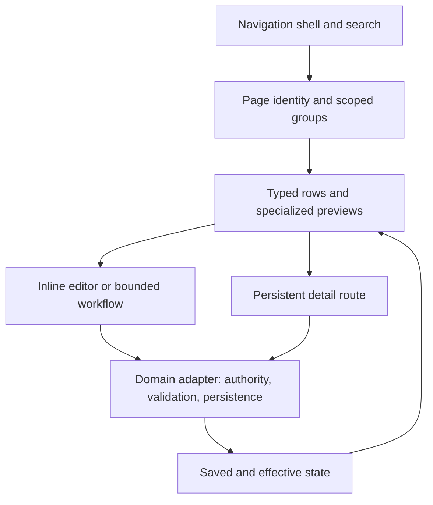

# Settings information architecture

Accepted 2026-10-01. This supersedes the earlier Settings-owned Reviews placement.

## Purpose and navigation

Settings answers “What do I want to change?” Keep configuration, setup, operational work, and
history distinct. Preserve a single canonical editor for each value and all existing deep links.

| Group | Primary destinations |
| --- | --- |
| Account | Profile, Connections, Security & access, Activity log |
| Personal | Goals, Motives, Rituals |
| Workspaces | Calendar, Tasks, Mail, Finances |
| App | Appearance, Wallpaper (native), Notifications (where supported), Texting, Desktop app, Desktop pet (native) |

Connections owns external-account management and links to connected-assistant credentials.
Security & access owns password/session controls, approval policy and the cross-workspace access
overview. Invitations are permission-gated within that area. Assistant-specific permission editing
remains at its existing canonical connection editor. Workspace pages link to scoped access details.
Setup is available from Profile and contextual workspace recovery, not a permanent sidebar item.
Wallpaper is a primary App sidebar page, with a persistent preview beside its controls. Desktop pet is a primary App destination, alongside Desktop app; it must remain directly reachable in both sidebar and narrow-layout navigation. Secondary pages remain
searchable, show their parent, and select their parent's sidebar row. Search indexes fields as
well as pages, including secondary destinations; platform and invitation permissions still apply.

## Work versus configuration

Reviews now opens as a shared dialog/drawer from the action beside each workspace Settings title
or its workspace attention alert; workspace search also offers **Items needing review**.
Today and Account overview do not offer additional review entry
points. The former queue layout is retained but hidden; see [Reviews](reviews.md).

The account Activity log is an audit of recorded changes and actors. It is not a universal record
of all product history. Ritual responses stay with Rituals, rule history with rules, and connector
history with connections. Do not claim aggregate history coverage that the API does not provide.

## Workspace page anatomy

Use the shared stacked SettingsSection and secondary SettingsRecord compositions. Lead with supported
configuration, not an agent introduction, capability brochure, or a repeated page title:

1. Sources and synchronization where supported: actual accounts, health and canonical management.
2. Rules where supported: active/proposed states, conditions/actions, review and pause controls.
3. Preferences and guidance: actual editable domain data, preserving versions and hidden fields.
4. Permissions and approvals: a scoped link to canonical access details.
5. Contextual setup/recovery: show outstanding setup; disclose diagnostic readiness details.

Mail and Tasks must not require an agent connection merely to inspect existing preferences.
Reuse the current rule activation preview and human approval flow; a switch cannot bypass it.
Do not invent toggles or imply provider capabilities to fill a template. Calendar and Finance keep
their domain editors; the shared workspace support sections follow the primary controls.

## Verification and scope

Check desktop/mobile navigation, legacy redirects and query preservation, field search into
secondary pages, permission/platform visibility, setup recovery, and populated/empty/error states.
Cover version-preserving guidance changes, failed writes, rule review and pause behavior.
This is the target structure; implementation evidence belongs in tests and the implementation log.

## Presentation and editing architecture

The [platform-agnostic settings model](settings.md#platform-agnostic-settings-model)
separates preferences, effective state, records, navigation, and commands. The
[engineering composition model](../../engineering/settings-ui-standards.md#typed-composition-and-ownership-model)
assigns navigation, groups, typed rows, editor state, and domain persistence to distinct
owners. It builds on the existing architecture; it does not move workspace-owned
configuration into centralized Settings or introduce a second source of truth.

This diagram describes the nohmi design boundary, not Apple's private implementation.

## Shared header

Every Settings page supplies its title to the shared workspace title slot and its
search, back action, and review action to the top utility slot. Search appears
once, at the top on both desktop and mobile. Page descriptions remain above the
settings groups; decorative centered icon/title cards are removed. Mobile uses
the shared two-row header and bounded bottom app bar with the full settings list
in More. Field search and deep links retain their existing behavior.

Settings publishes a wrapping breadcrumb in the shared top title slot: `settings /
current page`, including a linked parent on nested pages. Ancestors are links; the
current title remains the page heading and is never ellipsized on mobile.
