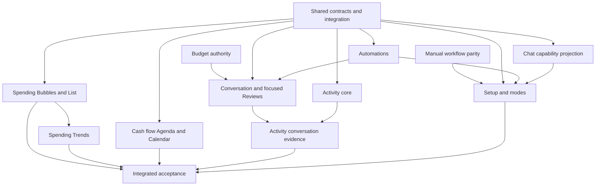

# Finance experience parallel workstreams

Status: delivery decomposition for review; no workers dispatched, no merge authorization implied.

## Delivery priority: maximum safe parallelism

Cooper explicitly prioritizes shipping as quickly as possible with as much parallel execution as
available capacity permits. Do not ask for approval of aesthetic sequencing. The waves below describe
dependency availability, not mandatory batch barriers: start every unblocked bounded assignment and
release each verified independent slice immediately under normal delivery authorization and gates.

- Split shared foundation work by contract family. A stream waits only for the specific interface or
  migration it consumes, never for all of B or another entire stream to finish.
- Freeze small versioned interface contracts early. UI and service workers can develop concurrently
  against agreed typed fixtures; consumer/provider contract tests must pass together before release.
  Fixtures enable development, not claims of completed integration or external capability.
- Extract shared primitives into small early changes. Spending bins can unlock Trends/Rhythm before
  bubbles ship; timeline occurrence/matching contracts can unlock payday work before Calendar ships.
- Use bounded file ownership and isolated worktrees. Delegate implementation across all available
  worker slots, rebalance as workers finish, and prioritize work that unblocks the most consumers.
  Do not create competing copies of domain logic to manufacture apparent independence.
- The integration owner is a coordination role, not a mandatory author of every adapter: reserve
  shared-file edits in short integration slots and merge narrow changes continuously. Contract-family
  owners may operate independently; schema/journal allocation and shared composition remain serialized.
- Reviews and focused verification run alongside unrelated implementation. Integrate accepted slices
  continuously; do not save all conflict resolution, coverage repair, or E2E work for the end.
- Unavailable dependencies may hide unfinished features, but never expose fake completion or introduce
  a setup gate before manual/automation-later journeys work. Required approval, audit, tenant isolation,
  and financial correctness gates remain release prerequisites.

This preference updates execution scheduling. It does not by itself assign an autonomous network
role, launch implementation in this planning turn, or waive repository merge authorization.

Read the [design](../specs/2026-10-18-finance-experience-design.md) and
[implementation tasks](2026-10-18-finance-experience.md). This document replaces the original
coarse sequential delivery order with explicit workstream dependencies. Requirements and acceptance
criteria remain in those documents. A workstream may contain several independently reviewed PRs.

## Ownership and shipping map

| Stream | Responsibility / task mapping | Hard dependencies | Independently shippable result |
| --- | --- | --- | --- |
| A — Budget authority | Task 1 authority portion; all active-budget mutation paths and MCP guidance | None | Human approval enforced across channels; no new UI required |
| B — Shared contracts and integration | Task 2 split into spending/preferences, schedule extensions, and conversation/evidence migrations; integration composition | None; consult A on approval evidence | Additive schemas/storage/preferences with existing consumers intact; no premature feature exposure |
| C — Spending | Tasks 3–4, then 12 Trends | B spending/preferences; historical approval policy agreed with A | Spending Bubbles/List first; Trends as a subsequent independent release using the same aggregate |
| D — Cash flow timeline | Task 13 | B timeline contract; existing canonical recognition/ownership helpers | Agenda/Calendar in Cash flow, without Chat or automation dependency |
| E — Automations | Task 5 | B schedule contract/storage | Registration, prompts, management, expected-run health; chat capability remains unavailable until F is live |
| F — Conversation and focused Reviews | Tasks 6–7 plus contextual Reply in Chat; evidence production portion of Task 8 | A approval boundary, B conversation/evidence, E verified protocol/registration | Complete durable message/receipt/evidence flow with contextual replies; gated to capable registrations |
| G — Activity | Task 8 projection/UI | B activity/evidence; existing audit records; F only for conversation excerpts | Financial Activity with honest existing audit detail first; conversation links enabled when F evidence exists |
| H — Manual workflow parity | Task 1 coverage inventory and Task 10 gap fixes | None for inventory; A for approval changes; B only for new interfaces | Small usable manual fixes independently, without forcing setup or automation |
| I — Setup and mode integration | Task 9 | B readiness/preferences, E registration, H required manual paths; tested Chat capability projection; full F not required for locked Chat | Resumable setup with manual-later finish; enable global gate only after dependencies pass |
| J — Acceptance and reconciliation | Task 11 across every stream | Per-slice verification continuously; whole journey after C–I | Final combined acceptance evidence and reconciled implementation documentation |

A and H may inspect the same code, but only A edits approval services until its boundary lands.
G owns projection/UI; F owns production of conversation evidence at mutation points. The activity
projection must never infer missing excerpts or relabel an old agent approval as a human approval.

## Dependency graph

Setup can release with a tested locked/verified Chat capability projection before the full F
conversation experience. Its manual prerequisite is the onboarding-critical subset, not every H gap.
D must reuse existing accounting helpers;
it does not wait for bubble rendering. If C extracts a necessary new recognition primitive, B
integrates that primitive as a small shared prerequisite rather than coupling D to the whole screen.

## Parallel waves

### Wave 0: agree interfaces and discover gaps

Run A authority implementation, H tool/UI inventory, and B contract work independently. C/D/E/F/G
may design fixtures and consumer tests against reviewed contract drafts, but must not each invent
separate schemas. Contract completion is per family, not one all-or-nothing foundation project.

B first locks spending/time/money/filter interfaces and timeline occurrence semantics. In parallel,
B coordinates schedule/check-in/capability and message/evidence shapes with E/F. Use one integration
owner to apply shared exports, migrations, route composition, and preference additions.

### Wave 1: independent functional slices

After their contract families land, C builds aggregate plus Bubbles/List; D builds timeline; E builds
registration/health; G builds existing-audit Activity. H closes bounded manual gaps. These can ship
independently if they meet the gates below. No global setup gate in this wave.

### Wave 2: dependent experiences

F builds end-to-end messages, receipts, claims, action evidence, and contextual Reviews handoff on E.
C adds Trends once the spending aggregate is stable. I builds onboarding and mode behavior against
completed registration and manual paths. G adds conversation evidence once F provides it.

### Wave 3: complete workspace integration

I activates the setup gate only after manual-later and pending-verification journeys work end to end.
J validates the combined journey, existing-user transition, source failure, and host recovery, then
reconciles target versus shipped documentation. Feature-specific releases need not wait for this
whole-workspace milestone unless a dependency explicitly requires it.

## Interface handoffs and acceptance gates

| Producer → consumer | Handoff | Consumer may not assume |
| --- | --- | --- |
| B/C → C UI, Trends | Complete API aggregate, money/currency, freshness, filter and historical budget semantics | A loaded transaction page is a complete aggregate |
| B → D | Timeline occurrence identity, date certainty, source refs, expected-to-actual linkage | A guessed date is scheduled or a balance projection is available |
| E → F/I | Registration ID, authenticated binding, health, next expectation, verified message capability | A schedule record or generic check-in proves chat capability |
| F → G | Immutable messages/excerpts, canonical case refs, action/audit links, execution outcome | Read, answered, and applied are equivalent |
| A → F/H/I | Exact human approval contract and rejection of agent bypass | Conversation wording is an authenticated approval |
| H → I | Tool/UI coverage matrix and passing manual completion journeys | Hiding controls removes need for manual support |
| I → shell | Explicit onboarding state and mode projection | Provider failure means onboarding must restart |

Registration and chat verification must remain separate during staged release. An automation created
before chat protocol support can maintain finances but cannot unlock chat until it confirms the new
capability. Prompts are versioned; older issued prompts remain inspectable and receive clear upgrade
instructions when capability changes. Do not silently mark old registrations verified.

## Writable boundaries and integration ownership

Each implementation worker must have an isolated managed worktree and bounded file ownership.
These are planned assignments, not active delegation or an autonomous network-role assignment.

- **A:** approval services, compatibility budget mutations, approval tests and authority guidance.
- **B:** domain contract exports, workspace preference schema, database schema/migrations/journal,
  API service registration/routes, typed client integration, shared navigation composition.
- **C:** spending aggregate module, bubble/list/trend modules, their unit/integration/UI tests.
- **D:** timeline service and Cash flow views; coordinate existing cashflow-page ownership with H.
- **E:** schedule lifecycle/recognition/prompt modules and Automations UI.
- **F:** conversation service, evidence attachment, Chat and contextual Reviews handoff.
- **G:** Activity read projection and UI; audit-gap writes routed through the owning mutation stream.
- **H:** coverage inventory and named manual gaps; reserve each affected editor before editing.
- **I:** onboarding/readiness and setup UI; settings-mode composition through B.
- **J:** shared E2E fixtures, cross-stream tests, consolidated delivery evidence and documentation.

No two workers concurrently edit the shared route/client/schema/navigation files. Domain owners
provide narrow adapter changes to B or integrate them sequentially after rebasing. Migration numbers
are allocated at integration, not independently in multiple worktrees. No opportunistic broad refactors.
Small teams can reuse workers across waves; the number of streams is not a concurrency requirement.

## Release gates by slice

- **A:** prove all active-budget entry points reject self-approval and preserve authenticated human flow.
- **C:** server/UI totals and transaction drill-down agree; history/no-budget/multi-month/pending cases
  are correct; desktop/mobile/reduced-motion checks pass. Trends can ship later without placeholder tabs.
- **D:** timeline is useful without a forecast; transfers/card payments and expected/actual matching
  cannot double count; Agenda/Calendar agree and unknown dates remain visible.
- **E:** prompt/ID/cadence management and overdue recovery work; explicitly do not promise immediate
  invocation or chat when its protocol is unavailable. Confirm one supported external-host flow.
- **F:** durable send through scheduled fetch/ack/reply to financial action and evidence is tested;
  duplicate and failed runs preserve one effect; exact budget approval cannot be bypassed.
- **G:** existing history is honest and owner-isolated; conversation provenance is required for new
  conversation-driven actions once F is enabled, not fabricated for legacy actions.
- **H:** every user-facing maintenance capability has a usable tested UI path or explicit unavailable
  state with reason; no unexplained manual coverage gaps in the setup-supported path.
- **I:** both automation-later and pending-verification can finish; existing answers/records survive;
  all mode transitions preserve corrections and review access; no accidental API/MCP setup deadlock.
- **J:** focused tests per stream, required full verification per candidate under delivery policy,
  and production-equivalent evidence for external boundaries. No repeated full suite solely because
  metadata changed; no claim that mocked host execution proves live delivery.

Every slice follows repository PR/Linear and review requirements. This decomposition does not grant
permission to merge, deploy, or create independently scheduled chats. Keep final unresolved product
choices in the design; technical discoveries that alter behavior must be surfaced rather than hidden
as stream-specific assumptions.

## Next decomposition step

Before dispatch, turn each stream's referenced tasks into a bounded assignment with owned files,
contract versions, prerequisites already landed, acceptance commands, and a definition of independently
shippable completion. Keep one coordinator responsible for integration ordering and final acceptance.
The current request produces this map; implementation has not started.

## Approved follow-on parallel streams

All five are approved program scope, not a speculative backlog. Schedule them as soon as the listed
prerequisites are available; they do not hold the core release hostage. They live within existing
Finance destinations rather than expanding the sidebar by five pages.

| Stream | Task / destination | Hard dependency | Independent shipping boundary |
| --- | --- | --- | --- |
| K — Spending rhythm | Task 14 / Spending | C aggregate and dated-bin contract | Heatmap with exact matching totals and drill-down; no Chat dependency |
| L — Recurring-cost ladder | Task 15 / Cash flow Bills & subscriptions | Existing recurring data and B projection contract | Normalized recurring costs and source links; can start in Wave 1 |
| M — Payday-to-payday | Task 16 / Cash flow | D timeline correctness and reliable income scope | Evidence-qualified cycle view; unknown projection remains unavailable |
| N — Reimbursement journey | Task 17 / Cash flow Reimbursements | Existing reimbursement ledger; B any read extension | Core journey can ship in Wave 1; F/G provenance enhancements follow |
| O — Goal scenarios | Task 18 / Wealth, linked from Scenarios | Goal/scenario contract; A for proposal handoff | Hypothetical comparison with no actual financial mutation |

K owns rhythm UI and consumes C's daily aggregation rather than copying accounting. L and M own
separate projection modules; coordinate Cash flow composition with D through the integration owner.
N owns reimbursement presentation; H retains existing manual reconcile mutation behavior. O owns
goal-specific hypothetical math and presentation, not the existing budget authority service. B owns
new schema/route/client integration; J owns shared fixture/E2E integration. All writable work remains
isolated and assigned only when dispatch is requested.

Recommended availability: L/N can develop alongside core Cash flow/Spending after contracts; O can
follow authority and a bounded scenario audit; K follows dated aggregates; M follows the reliable
upcoming-money timeline. Each gets independent acceptance and release evidence. Whole-program
completion includes K–O, while the core workspace milestone still ends with its original gates.

## Review-confirmed dependency refinements

- D needs an explicit recurrence occurrence/matching foundation; M can develop against its frozen
  contract but cannot ship a precise projection before balance-snapshot inclusion is correct.
- N core consumes allocation-owned reimbursement identities; grouped journeys preserve those IDs.
  Correction/unmatch requires a bounded N/H domain operation and audit tests, not just a read adapter.
- E needs a generic polling registration contract; F verification is a real protocol handshake.
  E can ship schedule management first, keeping unverified Chat locked.
- F automatic reassignment applies only to unclaimed inputs. Claimed-work transfer uses explicit
  guarded recovery. F owns provenance production; G projection consumes it.
- I does not wait for all F or H: readiness and onboarding-critical human flows are the release gate.
- Trends and Rhythm can build concurrently once shared contribution/bin contracts and a route shell
  exist; neither waits for the other visualization or bubble physics.
- O view-only projection may ship before proposal handoff; confirmed progress and bounded arithmetic
  remain requirements even for the earliest release.
